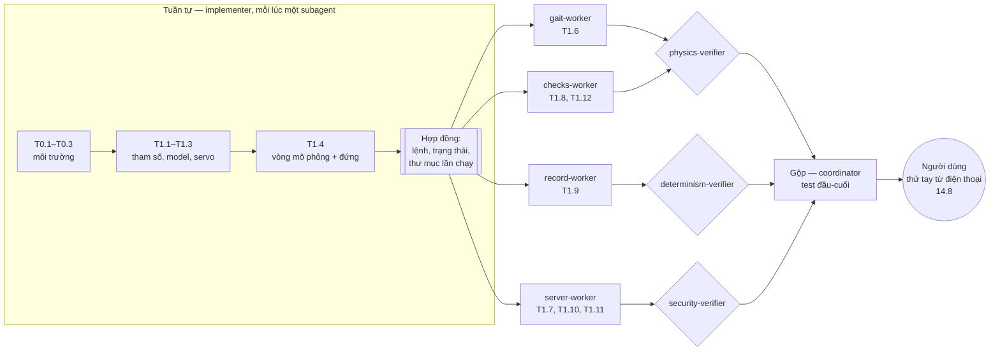

# Task graph: chia việc cho agent ở Phase 1

Cơ sở:
- Graph engineering (half 2, task graph): cạnh giả, mẫu kim cương, luật dừng, cổng người, 4 giới hạn.
- Harness² (google-research/harness2): Propose–Probe–Compose ở mức task, rồi đúc kết bài học ở mức harness.

Dữ liệu máy đọc được của trang này nằm trong `docs/kb/curated.toml` (PERFORMS, REVIEWS, WRITES, DEPENDS_ON).
Truy vấn: `uv run tools/kb.py deps T1.11`, `uv run tools/kb.py show role:server-worker`.

## 1. Luật dừng: chỉ tách phần thật sự độc lập

| Đoạn việc | Tính chất | Cách làm |
|---|---|---|
| T0.1 → T0.3 → T1.1 → T1.2 → T1.3 → T1.4 | Tuần tự. Bước sau cần kết quả của bước trước | **Một subagent `implementer` mỗi lúc**, lần lượt (17.3) |
| Sau T1.4: T1.6, T1.7, T1.8, T1.9 | Độc lập, không đọc kết quả của nhau | **Song song**, mỗi worker một nhánh |
| T1.10, T1.11 | Cần server của T1.7 | Cùng worker với T1.7, chạy tuần tự |
| T1.12 | Cần bộ kiểm tra của T1.8 | Cùng worker với T1.8 |

Cạnh giả đã bỏ: T1.7 (server) **không** cần T1.6 (dáng đi) mới bắt đầu được. Server thử với lệnh "đứng yên" trước, dáng đi ghép vào khi gộp.

## 2. Hình kim cương

**Hợp đồng** do coordinator viết thành tài liệu ở `docs/harness/contracts.md` ngay sau T1.4, trước khi tách việc. Implementer chuyển hợp đồng thành code. Gồm:
- Dạng JSON của lệnh controller và của trạng thái robot (14.10, 14.11).
- Định dạng thư mục lần chạy (11.5).
- Giao diện của vòng mô phỏng: hàng đợi lệnh, móc ghi log.

Worker chỉ được dựa vào hợp đồng. Muốn đổi hợp đồng thì phải báo coordinator.

## 3. Vai trò

| Vai trò | Làm | Được ghi vào (một người ghi mỗi file) |
|---|---|---|
| coordinator (phiên chính) | **Chỉ điều phối** (17.2): giao task, gọi verifier, gộp nhánh, viết hợp đồng (tài liệu), ghi quyết định, giữ KB và cấu hình harness. Không viết code | `AGENTS.md`, `CLAUDE.md`, `harness.toml`, `docs/decisions/`, `docs/kb/`, `docs/harness/`, `docs/reference/`, `docs/superpowers/`, `.claude/`, `.codex/`, `.githooks/` |
| implementer | T0.1–T1.4 lần lượt, sửa `tools/` khi được giao | `pyproject.toml`, `uv.lock`, `spider/__init__.py`, `spider/model/`, `spider/sim/`, `tools/`, `blender/`, `models/`, `.gitignore`, `tests/test_env.py`, `tests/test_scene.py`, `tests/test_config.py`, `tests/test_blender.py`, `tests/test_build.py`, `tests/test_model.py`, `tests/test_view.py` |
| gait-worker | T1.6 | `spider/gait/`, `tests/test_gait.py` |
| checks-worker | T1.8, T1.12 (viết script hook; coordinator nối vào config) | `spider/checks/`, `tests/test_checks.py` |
| record-worker | T1.9 | `spider/record/`, `docs/bugs/`, `tests/test_record.py` |
| server-worker | T1.7, T1.10, T1.11 | `spider/server/`, `spider/cli.py`, `web/`, `tests/test_server.py` |
| physics-verifier | Soát T1.4, T1.6, T1.8: số liệu có hợp lý không? | Không ghi gì |
| determinism-verifier | Soát T1.4, T1.9: chạy lại có giống hệt không? | Không ghi gì |
| security-verifier | Soát T1.7, T1.10, T1.11: lách được khoá không? | Không ghi gì |
| người dùng | Cổng duyệt (mục 5) | — |

Mỗi verifier trả lời **một câu hỏi khác nhau**, ở **context riêng** (không phải agent đã viết code). Kết luận phải dựa vào con số đo được, không dựa vào lời tự khai của worker.

Trên Claude Code, implementer và worker chạy trong git worktree riêng (`isolation: "worktree"`), commit trên nhánh riêng. Coordinator gộp bằng `git merge --ff-only` sau khi test và verifier qua (17.4). Hook `coordinator-guard.sh` chặn phiên chính sửa code ở checkout chính (17.5). Verifier nằm ở `.claude/agents/` và chỉ đọc.

**Mỗi lần giao việc**, coordinator gửi cho subagent:
- task và khối Interfaces của task đó, lấy từ kế hoạch;
- các file nó được ghi (bảng trên);
- lệnh test phải qua;
- câu "chạy `uv run tools/kb.py impact <mã>` cho các quyết định liên quan trước khi sửa".

Subagent trả về: nhánh, commit, kết quả test, và mọi điểm lệch khỏi kế hoạch.

## 4. Bốn giới hạn

1. Vòng sửa ↔ kiểm: tối đa **3 vòng**. Quá 3 vòng thì dừng và hỏi người dùng.
2. **Một người ghi mỗi file.** Luật này được `tools/kb.py check` kiểm tự động.
3. Thứ tự việc nằm ở trang này. Agent chỉ làm phần việc của mình, không tự đổi kế hoạch.
4. Tối đa **4 worker** chạy song song, cộng 3 verifier.

## 5. Cổng người dùng (chỉ đặt ở chỗ sai thì khó đảo ngược)

- Đẩy repo lên remote, hoặc tạo remote.
- Bất cứ thay đổi nào về Tailscale: chia sẻ máy, ACL. `tailscale funnel` thì cấm hẳn.
- Tạo hoặc thu hồi khoá điều khiển.
- Nâng phiên bản `mujoco` đã ghim, vì làm hỏng replay của bug cũ.
- Xoá thư mục lần chạy hoặc bug.
- Sửa luật luôn bật trong `AGENTS.md` hoặc `harness.toml` (thay đổi harness).
- Thử tay lần cuối từ điện thoại (14.8).

Gộp code vào `main` **không** cần cổng người, vì đã có test và verifier.

## 6. Vòng Propose–Probe–Compose (mức task, theo Harness²)

Dùng khi một thay đổi thiết kế chưa chắc chắn, ví dụ kích thước chân, chọn servo, thông số dáng đi:

1. **Propose:** đề xuất 2–3 phương án.
2. **Probe:** chạy từng phương án qua bộ kiểm tra khả thi hoặc một lần mô phỏng có ghi log (11.5). Có thể chạy song song, mỗi phương án một worktree.
3. **Compose:** so sánh số đo, chọn hoặc gộp phương án tốt nhất. Ghi quyết định vào `docs/decisions/`, kèm mã lần chạy làm bằng chứng.

Tối đa 3 vòng.

## 7. Đúc kết sau mỗi task (mức harness, theo Harness²)

Sau khi gộp một task, coordinator tự hỏi: có gì làm agent đi sai hoặc tốn công không?

- Nếu có: ghi một bài học vào `docs/harness/lessons.md`. Bài học phải kèm bằng chứng (mã bug, mã lần chạy, commit).
- Bài học lặp lại từ 2 lần, hoặc gây hậu quả nặng: đề xuất thêm thành **luật luôn bật** trong `AGENTS.md`. Người dùng duyệt (mục 5).
- Không thêm luật nào mà không có bằng chứng (10.10).
