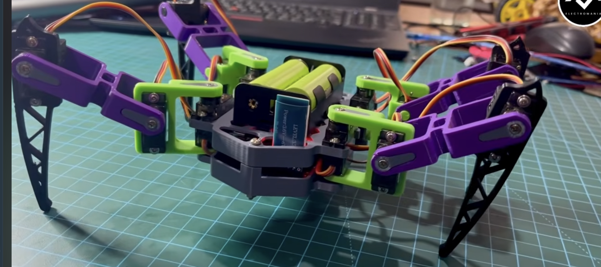

## Hook

Five steps into the first design conversation, Claude wrote decision 5.5: the job is small, a description in chat plus one file is enough, no separate design document needed. By the end of that same day, 20 October 2026, the project had eighteen numbered files of decisions, a plan reviewed by two sub-agents, a rulebook for physics and security, a design for a web controller and a task graph. Not one line of code existed yet.

This post is about that day: what I got wrong, what the agents got wrong, and the habit that made those mistakes cheap.

## Context

I want to build a four-legged spider robot. Each leg has three servos, small motors that turn to whatever angle you command, so twelve in total. The starting point was a photo of someone else's hobby build (at the bottom of this post). There is no hardware yet. The first goal is a robot that walks inside MuJoCo, a physics engine that simulates bodies, motors and contact with the floor, on my MacBook, and that I can drive from my phone.

I do this with Claude, an AI coding agent. Every decision we make goes into a numbered table in [`docs/decisions/`](https://github.com/katan-chan/robot/blob/main/docs/decisions/README.md) (written in Vietnamese, my working language). Decision 5.5 means step 5, item 5. A row is never deleted. When we change our minds, the old row is marked "replaced by" the new one. That rule turned out to matter more than anything else we wrote that day.

## The problem

Four things went wrong. In two, the plan kept changing under us, mostly because of my answers. The other two were agent problems.

**The size estimate.** Decision 5.5 was Claude's proposal, and it did not survive the day. Nobody planned the growth. Each answer I gave opened new questions: how do I reach the robot remotely over a VPN, what stops it in an emergency, how does an agent get access to it. The record shows the result, decision steps 6 to 18 all dated the same day. It does not show the moment the estimate flipped, and I won't reconstruct one after the fact.

**The tool chain changed twice before any code.** Claude first proposed Blender, a 3D modelling program, feeding an XML robot description (MJCF, MuJoCo's file format) into MuJoCo ([decision 3.1](https://github.com/katan-chan/robot/blob/main/docs/decisions/03-phan-cung-may.md)). In an independent review of the plan this became decision 3.2, and I confirmed it: the robot's measurements live in a text file, a Python script generates the MJCF, and Blender only exports meshes for display. Later the same day I reversed that ([decision 18.1](https://github.com/katan-chan/robot/blob/main/docs/decisions/18-blender-nguon-chinh.md)): Blender is where the robot's shape is edited, and the model is exported from Blender into MuJoCo. Blender first, then parameters first, then Blender first again. The decision file records what I decided, not why, so I won't invent a reason now. The cost was real: the plan for the first milestone had to be rewritten.

**A reviewer suggested a feature that does not exist.** In step 9, two review sub-agents read the plan. A sub-agent is a separate Claude instance with one narrow job and its own context. One of them suggested modelling the servos with a MuJoCo actuator type called `pid` with a `slewmax` option, a built-in speed limit on the command. It sounded right and it fitted the plan.

**The main agent was not supposed to write code.** I decided that the main Claude session should only coordinate ([decision 17.2](https://github.com/katan-chan/robot/blob/main/docs/decisions/17-dieu-phoi-subagent.md)): plan, hand out work, call reviewers, merge, record decisions. All product code goes to sub-agents, each in its own git worktree, a separate checkout of the repository where it cannot trample the main copy (17.3, 17.4). But a rule written in a file is easy for an agent to forget, or to argue its way around.

## What we tried

For the reviewer's suggestion, Claude checked every new-sounding MuJoCo feature the reviewers named against MuJoCo's official changelog before accepting any of them. Three were real: the `dcmotor` actuator and "reflected" damping and armature (both from version 3.7.0), and command delay (3.5.0). `pid` with `slewmax` was in neither the changelog nor the XML reference. The same check corrected another confident claim: `mjpython`, a special launcher on macOS, is needed for one viewer call, not for all of them.

For the coordinator rule, Claude added a hook (17.5): a small script the agent platform runs before the agent edits a file. It blocks the Edit and Write tools on `spider/`, `tests/`, `tools/`, `web/`, `blender/`, `models/`, `pyproject.toml` and `uv.lock` in the main checkout. Inside a worktree it does nothing.

Then the hook ran into the platform itself. The next day, Claude Code's "auto mode" safety classifier blocked the main session from handing work to sub-agents. It read "the main session is barred from code, so the work goes to sub-agents" as an attempt to get around a rule. It also blocked Claude from editing its own permission settings to fix that. A later session did the same delegation without being blocked, so the classifier does not behave the same way every time.

## The fix

- **Size.** Decision 5.5 is now marked "replaced: the project is bigger than expected; the design document is the `docs/decisions/` folder" ([f197fbd](https://github.com/katan-chan/robot/commit/f197fbd)). The wrong estimate cost one stale line in a table.
- **Tool chain.** Decision 18.1 split the work cleanly. Blender keeps the shape, where each joint sits, which way it turns, how far it can turn, and which servo sits at which joint. A TOML file (a plain-text settings format) keeps the physics that is not geometry: the servo catalogue, masses, friction, solver settings (18.4). MuJoCo does all the physics (18.2). The switch is [6960d7e](https://github.com/katan-chan/robot/commit/6960d7e), and the rewritten plan is [7e476c6](https://github.com/katan-chan/robot/commit/7e476c6). Decision 3.2 was marked superseded rather than deleted, which is why I can still tell this story.
- **The invented feature.** It was dropped from [decision 9.1](https://github.com/katan-chan/robot/blob/main/docs/decisions/09-review.md). Speed limiting stays in our own controller code, and each servo is a standard MuJoCo `position` actuator with force limits, with `dcmotor` written down as an upgrade path.
- **The coordinator rule.** The hook stays ([b755ee7](https://github.com/katan-chan/robot/commit/b755ee7)), and its limits are written next to it instead of hidden. It sees only the Edit and Write tools, so a shell command that edits a file gets past it; against that, the rule is words only (rule 7 in [`AGENTS.md`](https://github.com/katan-chan/robot/blob/main/AGENTS.md)). Codex, another agent tool I may use, has no such hook at all. For the classifier, lesson [L-003](https://github.com/katan-chan/robot/blob/main/docs/harness/lessons.md) says: run the plan in normal mode, or I add the permission by hand. An agent never raises its own permissions. Decision 17.11, where I make that edit myself, is still waiting on me.

## Lessons

- A plausible technical claim from an agent reviewer counts only after it has been checked against the primary source. The `pid` and `slewmax` suggestion was fluent, specific, and a good fit. It just was not real.
- My tool chain changed twice in one day, and the "small project" estimate broke within hours. Neither was a disaster, because nothing was deleted. "Replaced by" is the cheapest undo I know.
- A rule an agent must follow should be enforced by a machine where possible, and the machine's blind spots should be written down beside it. Otherwise the rule quietly becomes optional.
- Safety layers can collide. The platform's classifier and my hook were each doing their job. The right answer was for the human to step in, not for the agent to loosen its own limits.

## Pictures and video

*The reference photo the robot is based on (decision 4.1): four legs, three servos per leg, batteries on top. It is someone else's hobby build, not ours.*

There are no other pictures from this day. It was all text.

## Next

One question from the brainstorm stayed open: where should I look at the robot to approve it? The first gate, G1, a checkpoint where I must sign off before work continues, says I see the 3D model and its parts before anything else is built (16.2). Claude first chose MuJoCo's own viewer (16.4). After I made Blender the main editor, the gate moved to Blender (18.3). Instead of arguing it out in advance, we built both views. The next post is about G1, and about which view I actually ended up using.
