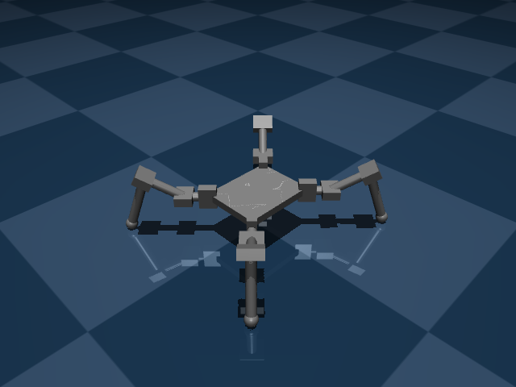
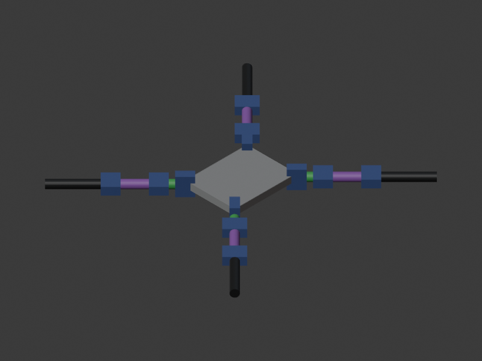

## Hook

The work for G1 was split into six tasks. After each one, a separate reviewer agent read that task's changes and answered Approved. Six tasks, six approvals. Then one more reviewer read the whole branch at once and found that the MuJoCo cameras were looking at the robot from different sides than the Blender cameras. Every piece had passed review, and the pieces did not fit together.

A day later I looked at the finished robot myself and asked for something none of the eighteen earlier decision steps had mentioned.

## Context

A gate is a checkpoint where I, the human, must look at the work and sign off before anything else gets built. G1 is the first one: I see the spider's 3D model and its parts ([decision 16.2](https://github.com/katan-chan/robot/blob/main/docs/decisions/16-gate-dau-tien.md)). The robot is built from simple shapes in Blender, a 3D modelling program, and exported into MuJoCo, a physics engine that simulates bodies, motors and contact with the floor.

The team: the main Claude session only coordinates. Sub-agents, separate Claude instances each given one job, write the code, each in its own git worktree (a separate checkout of the repository). Other agents review each task, then the whole branch. The work ran from 20 to 22 October 2026. Decision files are in Vietnamese; I summarise them here.

## The problem

**The robot was too heavy.** Decision 9.5 set a mass budget of 250 to 350 g. The reason is torque, the turning force a servo motor can produce: tiny hobby servos have little of it, and the rule is that while the robot stands on three legs, no servo may need more than 50 percent of its maximum. The sub-agent that built the model made the torso a solid block 35 mm thick, the plan's starting size. The robot came out at 417 g, and the budget test failed. The torso alone was 122 g.

**Reviews that only see one piece.** Besides the cameras, the whole-branch review found two more important problems. No test had ever run on the Blender file actually committed to the repo, `models/spider.blend`; every test built a fresh model in a temporary folder. And a torque risk was invisible at G1; it came back later, as you will see. The cause of the camera mismatch was simple. The Blender task and the MuJoCo snapshot task each followed their own brief, and the convention linking them, which side of the robot is "front", was in neither. Each reviewer saw one diff, so nobody compared the two.

**Quiet failures.** The same review collected minor issues that earlier reviews had deferred as "later, nothing depends on it". Each was a way for the system to fail without saying so:

- A scale check read only an object's `scale`, so an object resized another way in Blender slipped through ([abaea81](https://github.com/katan-chan/robot/commit/abaea81)).
- A zero in one config value would crash with a division by zero far from the cause ([7a05354](https://github.com/katan-chan/robot/commit/7a05354)).
- A failed export could leave stale or half-written files behind ([52975d8](https://github.com/katan-chan/robot/commit/52975d8)).
- Floor contact used the last foot's size for every foot ([1f40ed1](https://github.com/katan-chan/robot/commit/1f40ed1)).
- Some tests compared names against the same list the code used, which proves nothing ([3f94df1](https://github.com/katan-chan/robot/commit/3f94df1)).
- A hung Blender would hang the agent forever ([bc472c0](https://github.com/katan-chan/robot/commit/bc472c0)).

**Then my turn.** At the G1 review I opened the finished 330 g model in MuJoCo and found it not stable enough. I wanted the robot to carry a load, with balance as its main skill. My first figure was about 3 kg. This requirement existed nowhere in the earlier decisions, and it broke the weight budget and the servo choice that G1 had just been built around.

## What we tried

For the weight, the test was not skipped and the limit was not raised. Project rule 2 says: change dimensions before changing servos, and never loosen the 50 percent margin.

For the payload, Claude did not guess. It sent a sub-agent to probe in simulation (our "propose, probe, compose" method: try a few options, measure, then choose) with three leg layouts: A long and splayed, B short and splayed, C long and tucked. We also discussed 5 to 10 kg, which would need brushless motors and an aluminium frame, nothing like the reference photo. At 3 kg, none of the three layouts passed the torque check. At 2 kg, layout B used 52 percent at its hardest-working joint, just over the line. B with a stronger 40 kg·cm servo at that hip joint came in at 45 percent ([table in step 19](https://github.com/katan-chan/robot/blob/main/docs/decisions/19-tai-2kg-thang-bang.md)).

## The fix

- **Weight.** The coordinator ruled that the torso should be a flat 10 mm plate, which also matches the reference photo: two thin plates with a battery holder on top. Density, servos and battery stayed the same. Total mass fell to 330.3 g, inside the budget ([c121e68](https://github.com/katan-chan/robot/commit/c121e68), [parts table](https://github.com/katan-chan/robot/blob/main/docs/reference/g1/README.md)). The README flagged its own risk: a plate that thin may be too weak to hold a real battery.
- **Seams.** The MuJoCo cameras were moved to the same sides as Blender's, with tests that measure the camera position against Blender's view directions and check that the four images differ from each other ([c8d0d6e](https://github.com/katan-chan/robot/commit/c8d0d6e)). A new test exports the committed Blender file and checks the mass budget and the feet ([f68560d](https://github.com/katan-chan/robot/commit/f68560d)). Lesson [L-004](https://github.com/katan-chan/robot/blob/main/docs/harness/lessons.md) changes the process: when a task reuses a convention from an earlier one (view direction, key names, units), copy it into the brief, and make the final review check the seams between tasks. It is not a standing rule yet; that needs my approval.
- **Quiet failures.** All fixed in one wave before the gate, so the G1 images would not need rendering twice. Each one now fails loudly: a named field, a timeout of 300 s, a test that checks real values.
- **Payload.** I chose 2 kg. Claude recommended layout B with the 40 kg·cm hip servo, and I confirmed (19.1 to 19.8). Nobody lowered the 50 percent margin. The robot keeps the look of the photo, only bigger (19.2). The probe also found two real model bugs: foot friction had no effect, because MuJoCo uses the larger of two friction values and the floor's default of 1.0 always won; and feet crept sideways under a steady push, because of the contact settings. Both must be fixed with a regression test before G1 passes (19.9). One honest caveat, written into decision 19.4 itself: the servo numbers are estimates until there is a datasheet or a real servo to measure.
- **Where to look.** The plan said I would review the model in Blender (18.3). In practice I settled it the other way: to view or check the model, open only MuJoCo; Blender is for editing shape (19.10). Claude keeps that as a standing memory note: "to show the model, open MuJoCo viewer, not Blender".

## Lessons

- Six approvals did not add up to one working whole. Reviewing each piece in isolation cannot catch a mismatch that lives between pieces. Someone has to own the seams, and the brief has to carry the conventions across.
- A failing budget test is information, not an obstacle. Thinning the torso was the fix; raising the limit would have hidden a real problem.
- My new requirement arrived late and broke things the agents had just finished. The useful response was not to argue or guess but to measure three options and let the numbers choose.
- I did not know which view I wanted until I used both. Building both was cheaper than deciding in advance.

## Pictures and video

*G1 in MuJoCo, iso view.*

*The same model and the same angle, rendered in Blender. After the camera fix, both programs agree on which side is which.*

<video src="../media/g1/orbit.mp4" controls muted loop playsinline></video>

*An eight-second orbit around the 330 g G1 model in MuJoCo.*

## Next

G1 has not passed yet. The two contact bugs need regression tests and fixes. And the robot in these pictures is about to change: a G1 revision for the 2 kg payload is in progress, with layout B's shorter legs, the stronger hip servos and a 2 kg box on the torso ([plan](https://github.com/katan-chan/robot/commit/6117c5f)).
