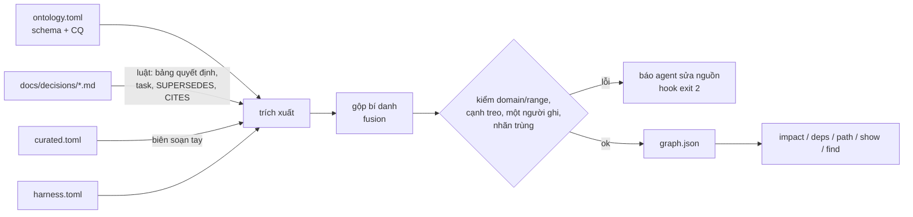
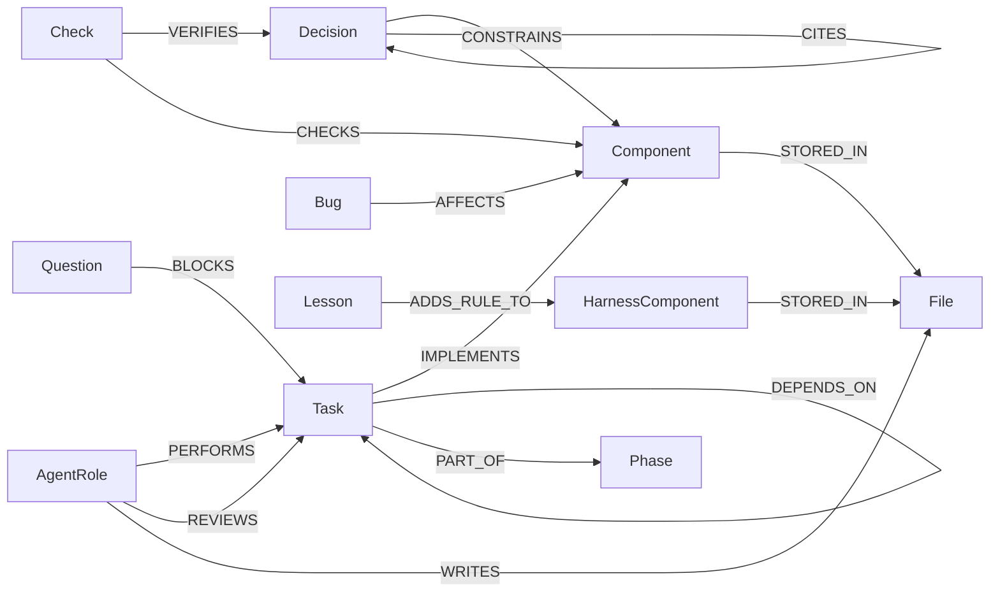
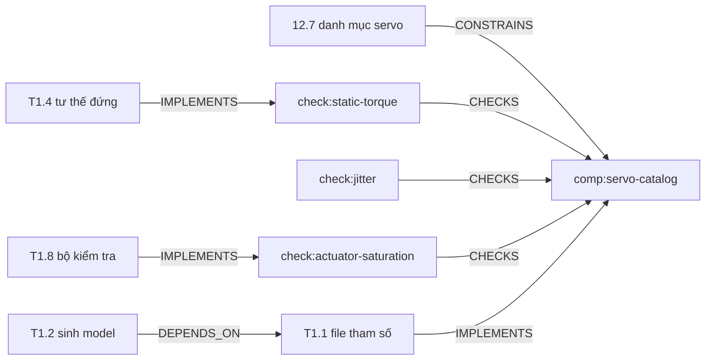

# Knowledge base (knowledge graph) của dự án

Graph nối **quyết định → thành phần → task → kiểm tra → vai trò agent → file**. Nhờ vậy, khi đổi một chỗ, agent biết ngay chỗ nào khác bị ảnh hưởng.

| File | Vai trò |
|---|---|
| [ontology.toml](ontology.toml) | Schema: loại nút, loại quan hệ (domain → range), câu hỏi năng lực CQ1–CQ12 |
| [curated.toml](curated.toml) | Phần biên soạn tay: thành phần, kiểm tra, vai trò, quan hệ ngữ nghĩa, bí danh |
| `graph.json` | Kết quả sinh tự động. **Không sửa tay** |
| [../../tools/kb.py](../../tools/kb.py) | Pipeline + lệnh truy vấn |

## Pipeline (theo graph-engineering)

## Schema rút gọn

## Ví dụ: đổi danh mục servo (12.7) thì ảnh hưởng gì?

Lệnh tương ứng: `uv run tools/kb.py impact 12.7`

## Chất lượng (lần dựng đầu, 2026-10-20)

- 235 nút, 428 cạnh (gồm Bước 15). `selftest` qua đủ CQ1–CQ12.
- Lấy mẫu 50 cạnh CITES do luật trích xuất: 50/50 đúng. Lỗi đã sửa trong luật: số phiên bản ("Blender 5.2") bị nhận nhầm là mã quyết định.
- Bug và Lesson đã có trong schema nhưng chưa có dữ liệu. Thêm khi có bug hoặc bài học đầu tiên.
