# Cổng G1 — xem model 3D và các bộ phận

Model nguồn: [`models/spider.blend`](../../../models/spider.blend). Model MuJoCo dựng từ bản export của file này (`tools/blender export` → `build/model/` → `spider/model/build.py`).
Quyết định liên quan: 16.2, 16.3, 18.3. Ảnh tham khảo: [spider-reference.png](../spider-reference.png).

## Ảnh Blender và MuJoCo

Blender lưu model ở tư thế 0 (chân duỗi ngang). Ảnh MuJoCo `home` cũng ở tư thế 0, dùng để so với Blender. Ảnh `stand` là tư thế đứng.

| Góc | Blender (tư thế 0) | MuJoCo `home` | MuJoCo `stand` |
|---|---|---|---|
| Trước | 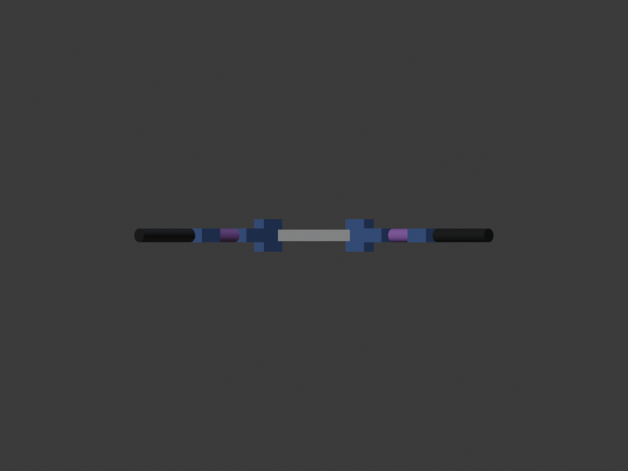 | 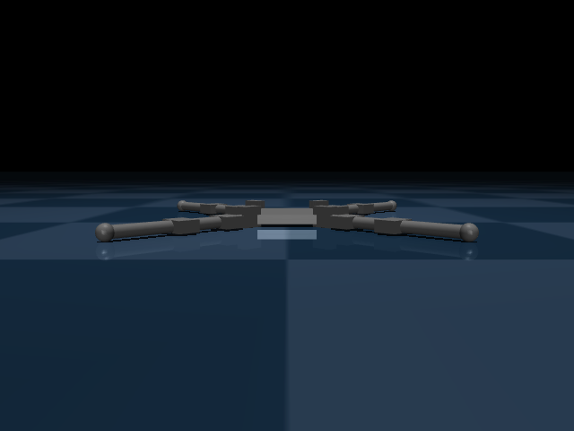 | 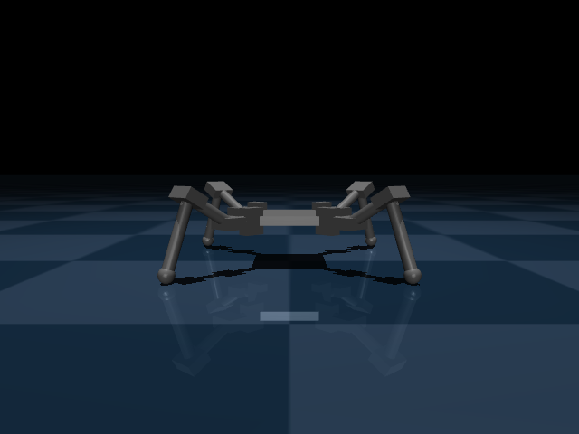 |
| Bên | 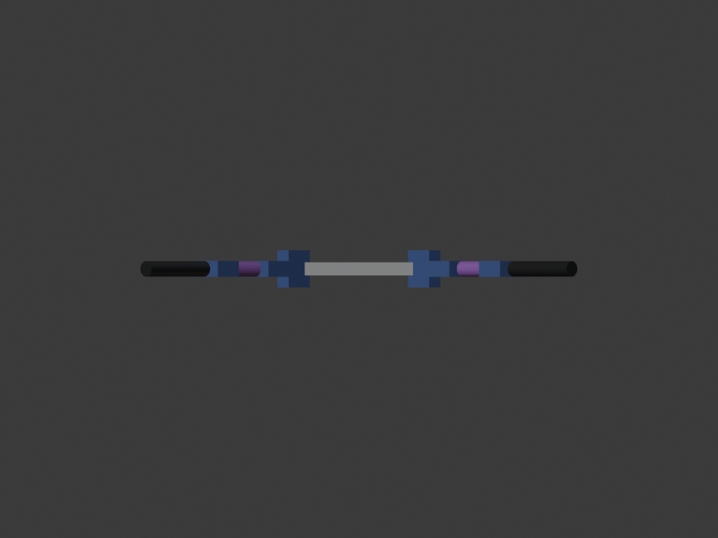 | 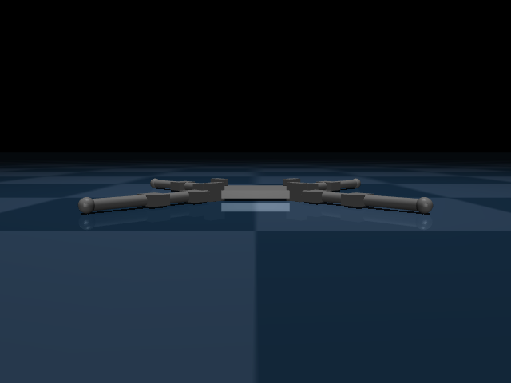 | 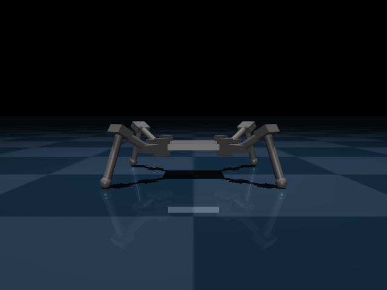 |
| Trên | 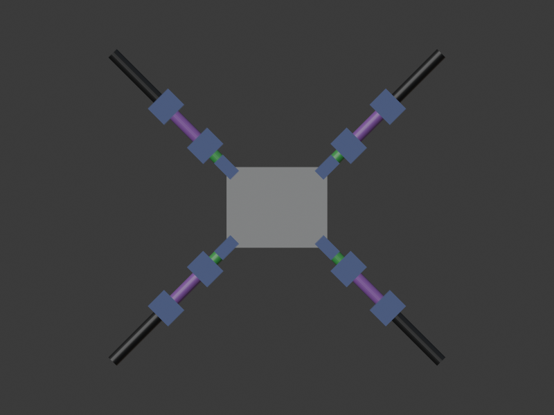 | 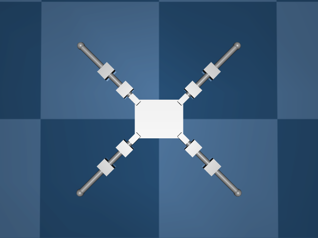 | 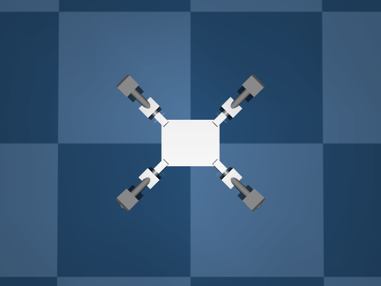 |
| Chéo | 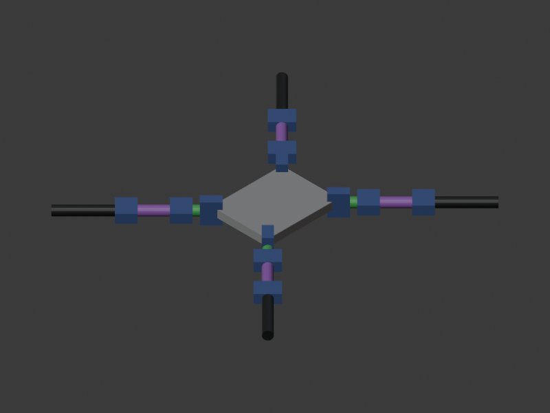 | 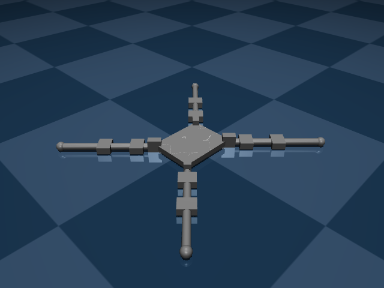 | 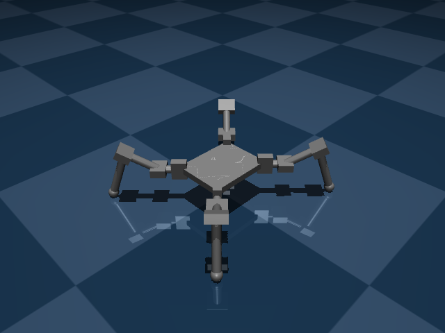 |

Ảnh trước và ảnh bên giống nhau vì 4 chân xếp chữ X đối xứng.
MuJoCo chưa tô màu từng bộ phận, mọi geom có màu xám. Màu chỉ có ở Blender.

## Bảng thành phần

In bằng `uv run python -m spider.sim.view --parts`. Khối lượng đọc từ MuJoCo (`m.body_mass`, `mj_getTotalmass`).

| body | parent | joint | range (deg) | servo | mass (g) | geoms |
|---|---|---|---|---|---|---|
| torso | world | root | - | - | 188.3 | torso_mesh, fl_hip_yaw_servo, fr_hip_yaw_servo, rl_hip_yaw_servo, rr_hip_yaw_servo, torso_geom |
| fl_coxa | torso | fl_hip_yaw | -60 .. 60 | MG90S | 14.9 | fl_coxa_mesh, fl_hip_pitch_servo |
| fl_femur | fl_coxa | fl_hip_pitch | -90 .. 90 | MG90S | 16.1 | fl_femur_mesh, fl_knee_servo |
| fl_tibia | fl_femur | fl_knee | -30 .. 150 | MG90S | 4.6 | fl_tibia_mesh, fl_foot_geom |
| fr_coxa | torso | fr_hip_yaw | -60 .. 60 | MG90S | 14.9 | fr_coxa_mesh, fr_hip_pitch_servo |
| fr_femur | fr_coxa | fr_hip_pitch | -90 .. 90 | MG90S | 16.1 | fr_femur_mesh, fr_knee_servo |
| fr_tibia | fr_femur | fr_knee | -30 .. 150 | MG90S | 4.6 | fr_tibia_mesh, fr_foot_geom |
| rl_coxa | torso | rl_hip_yaw | -60 .. 60 | MG90S | 14.9 | rl_coxa_mesh, rl_hip_pitch_servo |
| rl_femur | rl_coxa | rl_hip_pitch | -90 .. 90 | MG90S | 16.1 | rl_femur_mesh, rl_knee_servo |
| rl_tibia | rl_femur | rl_knee | -30 .. 150 | MG90S | 4.6 | rl_tibia_mesh, rl_foot_geom |
| rr_coxa | torso | rr_hip_yaw | -60 .. 60 | MG90S | 14.9 | rr_coxa_mesh, rr_hip_pitch_servo |
| rr_femur | rr_coxa | rr_hip_pitch | -90 .. 90 | MG90S | 16.1 | rr_femur_mesh, rr_knee_servo |
| rr_tibia | rr_femur | rr_knee | -30 .. 150 | MG90S | 4.6 | rr_tibia_mesh, rr_foot_geom |

**Tổng: 330.3 g** (ngân sách 250–350 g, 9.5).

Khối lượng thân 188.3 g gồm: tấm thân PLA 34.7 g, pin + mạch 100 g, 4 servo `hip_yaw` 53.6 g.

## Điều đã đổi so với kế hoạch

- **Thân dày 0.010 m thay vì 0.035 m.** Bản 0.035 m nặng 417 g, vượt ngân sách 350 g. Thân đặc 35 mm chiếm 122 g. Ảnh tham khảo cho thấy thân là tấm phẳng mỏng, hộp pin đặt bên trên, nên đổi thành tấm 10 mm. Mật độ, độ đặc, servo và khối lượng pin giữ nguyên. Nếu tấm 10 mm quá mỏng để gắn pin thật, cần chọn lại ở cổng này.

## Số liệu kiểm vật lý (physics-verifier)

- Tư thế `stand` giữ 2 s mô phỏng: đứng vững, thân lún 6 mm rồi dừng, không nghiêng. Servo `hip_pitch` dùng 30% mô-men cực đại, `knee` 14%.
- Tư thế `home`: đáy thân cách sàn 3 mm, chỉ 4 bàn chân chạm sàn.
- **Rủi ro:** thử nhấc một chân (đo thô), servo các chân còn lại dùng 49–52% mô-men cực đại, sát biên 50% (10.5, 14.5). Cổng khả thi T1.8 sẽ đo kỹ. Nếu không qua, đổi kích thước chân hoặc giảm khối lượng thân trước, rồi mới đổi servo.

## Cách xem trong Blender

1. Mở `models/spider.blend` trong Blender 5.2.
2. Outliner → collection `robot` để thấy cây link: `torso` → `{leg}_coxa` → `{leg}_femur` → `{leg}_tibia` → Empty `{leg}_foot`.
3. Chọn một link → phím N → tab Item → Custom Properties để xem `joint`, `kind`, `axis`, `range_deg`, `servo`.

**Trước khi lưu:** nếu đã xoay thử link trong Blender, đưa về tư thế 0 (chọn các link trong `robot` → Alt+R) rồi mới lưu. Tư thế lúc lưu chính là góc 0 của mọi khớp, và không công cụ nào phát hiện được nếu lỡ lưu khi đang xoay.

Sau khi sửa và lưu trong Blender, kiểm lại bằng `tools/blender inspect`.

## Cách xem trong MuJoCo

```sh
tools/blender export                       # dựng lại build/model từ models/spider.blend
uv run python -m spider.sim.view           # mở viewer, tư thế stand
uv run python -m spider.sim.view --keyframe home
```

Trong viewer:
- Bảng trái → *Rendering* → *Label*: chọn *Joint* để hiện tên khớp.
- Bảng phải → *Control*: kéo thanh trượt để quay thử từng servo.

## Checklist cho người duyệt

- [ ] 4 chân xếp chữ X, đúng thứ tự `fl`, `fr`, `rl`, `rr` (trước-trái, trước-phải, sau-trái, sau-phải).
- [ ] Chiều quay đúng: `hip_pitch` dương nhấc đùi lên; `knee` dương gập cẳng xuống; `hip_yaw` quay quanh trục đứng.
- [ ] Tỉ lệ giống ảnh tham khảo: thân khoảng 10 cm, chân duỗi khoảng 15 cm.
- [ ] Thân tấm 10 mm chấp nhận được.
- [ ] Tổng khối lượng 330.3 g hợp lý.
- [ ] Ảnh Blender và ảnh MuJoCo `home` trùng nhau.
